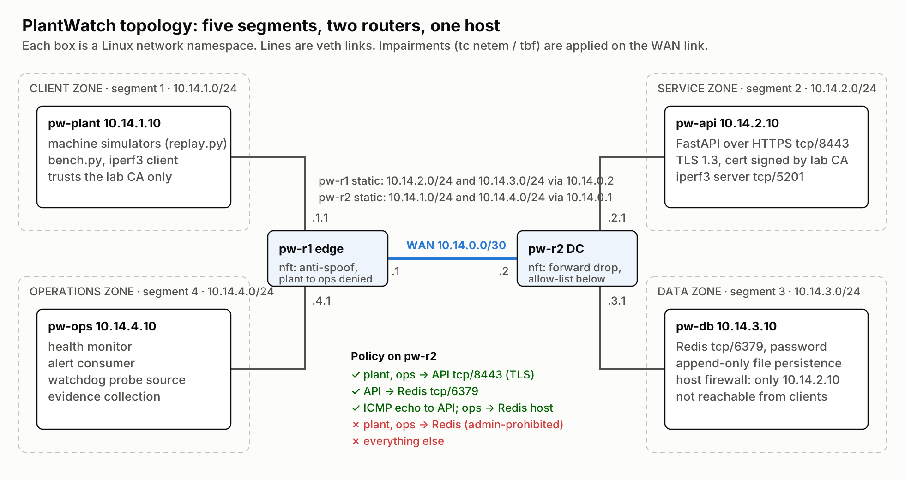
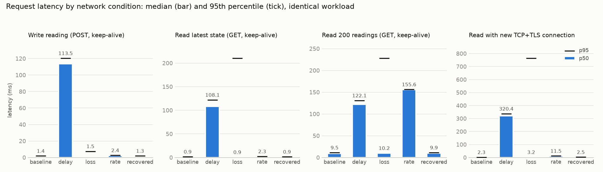
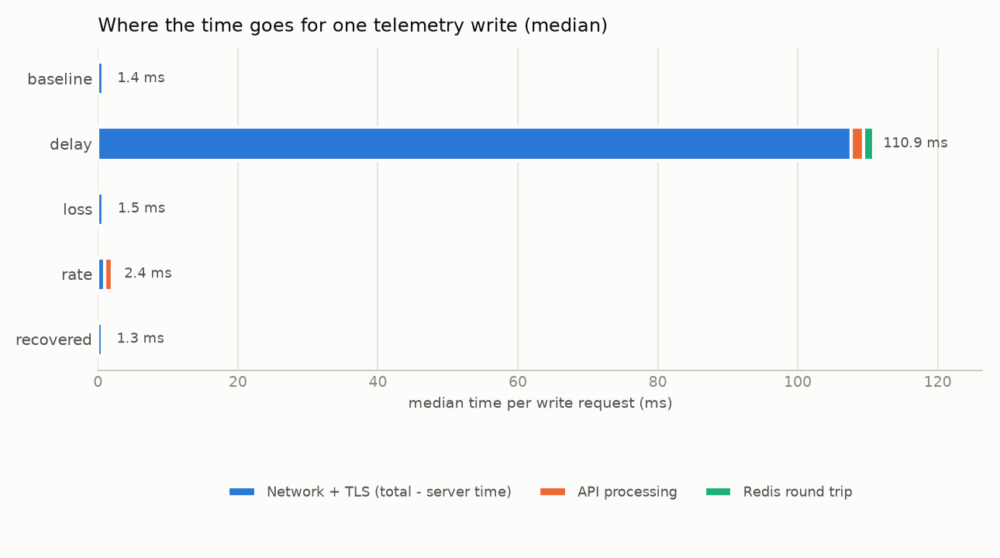
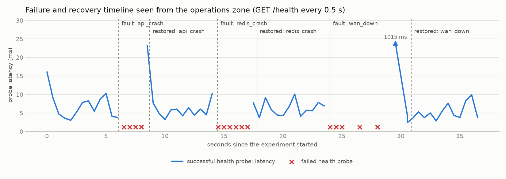

# PlantWatch: a secured, routed platform for industrial IoT telemetry

CSCI 414/514 Platform Based Development · Final Practical Exam · Option 14 (Industrial IoT and Predictive Maintenance)

Author: Dawa Sherpa (individual submission) · November 2026

Environment: Ubuntu 24.04.4 LTS, kernel 6.6.87.2-microsoft-standard-WSL2. All numbers, tables and terminal excerpts in this report were read from the `evidence/` folder of the repository by `experiments/build_report.py`.

## 1. Purpose and scope

PlantWatch collects sensor readings from machines on a plant floor, stores them in a NoSQL datastore in a separate data-centre network, and raises predictive-maintenance alerts that an operations team consumes. The application is deliberately small. The object of study is the network platform under it: segmentation, routing, access control, encryption, observability, behaviour under congestion, and recovery from failure.

| | |
|---|---|
| Inputs | Readings per machine: air temperature, process temperature, rotational speed, torque, tool wear |
| Outputs | Latest machine state, reading history, alerts |
| Operations | Create a reading, read state and history, update an alert threshold, read and acknowledge alerts |
| Stack | Linux network namespaces, nftables, FastAPI over TLS, Redis, tc netem / tbf, tcpdump, iperf3 |

## 2. Architecture



*Figure 1. Topology: four zones, five IP segments and two routers on one Linux host*

| Segment | Prefix | Members |
|---|---|---|
| 1 Client (plant floor) | 10.14.1.0/24 | pw-plant .10, pw-r1 .1 |
| 2 Application | 10.14.2.0/24 | pw-api .10, pw-r2 .1 |
| 3 Data | 10.14.3.0/24 | pw-db .10, pw-r2 .1 |
| 4 Operations | 10.14.4.0/24 | pw-ops .10, pw-r1 .1 |
| Transit (WAN) | 10.14.0.0/30 | pw-r1 .1, pw-r2 .2 |

**End-to-end transaction.** A client in segment 1 opens TCP and then TLS to 10.14.2.10:8443. pw-r1 forwards the packets over the transit link using a static route. pw-r2's firewall accepts tcp/8443 and forwards to the application segment. The API sends `HGET` and then one `MULTI ... EXEC` pipeline to Redis at 10.14.3.10:6379, again through pw-r2. The response returns along the same path with a request id and timing headers.

**Data placement.** Redis is one router hop from the API and three hops from the clients. A write costs the client one round trip over the WAN plus two Redis round trips inside the data centre, so the WAN dominates client latency as soon as it is impaired while datastore time stays constant (Section 6). Keeping the database off the client path is also what makes the rule "clients cannot bypass the API" enforceable.

## 3. Implementation and evidence by module

### 3.1 Module A: network infrastructure

`lab/up.sh` creates six namespaces and five veth links, assigns addresses, enables IPv4 forwarding on the two routers only, and installs static routes: a default route on each host and two /24 routes per router across the transit link.

Route tables of the two routers:

```text
--- pw-r1
10.14.0.0/30 dev r1-wan proto kernel scope link src 10.14.0.1
10.14.1.0/24 dev r1-plant proto kernel scope link src 10.14.1.1
10.14.2.0/24 via 10.14.0.2 dev r1-wan
10.14.3.0/24 via 10.14.0.2 dev r1-wan
10.14.4.0/24 dev r1-ops proto kernel scope link src 10.14.4.1
--- pw-r2
10.14.0.0/30 dev r2-wan proto kernel scope link src 10.14.0.2
10.14.1.0/24 via 10.14.0.1 dev r2-wan
10.14.2.0/24 dev r2-app proto kernel scope link src 10.14.2.1
10.14.3.0/24 dev r2-data proto kernel scope link src 10.14.3.1
10.14.4.0/24 via 10.14.0.1 dev r2-wan
```

Path from the plant zone to the API (two router hops) and baseline round-trip time:

```text
$ plant traceroute -n -I -q 1 10.14.2.10
traceroute to 10.14.2.10 (10.14.2.10), 30 hops max, 60 byte packets
 1  10.14.1.1  0.033 ms
 2  10.14.0.2  0.016 ms
 3  10.14.2.10  0.014 ms

10 packets transmitted, 10 received, 0% packet loss, time 1799ms
rtt min/avg/max/mdev = 0.023/0.118/0.236/0.063 ms
```

Connectivity matrix. "works" rows are intended paths; "blocked" rows are intended boundaries:

```text
  PASS  (works)   plant -> edge router        10.14.1.1
  PASS  (works)   plant -> dc router (wan)    10.14.0.2
  PASS  (works)   plant -> API                10.14.2.10
  PASS  (works)   ops   -> API                10.14.2.10
  PASS  (works)   ops   -> Redis host (ICMP only) 10.14.3.10
  PASS  (works)   API   -> Redis tcp/6379     10.14.3.10
  PASS  (blocked) API   -> plant host (data centre may not initiate)
  PASS  (blocked) plant -> Redis host         10.14.3.10
  PASS  (blocked) plant -> ops zone           10.14.4.10
Result: 9 passed, 0 failed
```

### 3.2 Module B: distributed service

The API is FastAPI served by uvicorn over TLS (`app/main.py`); Redis is the datastore. The key design follows the queries the API runs:

| Key | Type | Content | Query it serves |
|---|---|---|---|
| `machines` | SET | all machine ids | listing, existence checks |
| `machine:{id}` | HASH | latest values, status, `tool_wear_limit`, counter | latest state in one `HGETALL`; threshold update |
| `telemetry:{id}` | STREAM | time-ordered readings, capped | history with `XREVRANGE ... COUNT n` |
| `alerts` | STREAM | alert events of all machines | newest first; everything since an id |
| `alerts:acked` | HASH | alert id to acknowledgement time | acknowledge |
| `stats` | HASH | counters and import metadata | `/stats` |

| Method and path | Operation |
|---|---|
| `POST /telemetry` | CREATE a reading, UPDATE machine state, raise alerts |
| `GET /machines/{id}`, `GET /machines/{id}/readings` | READ latest state / history |
| `PUT /machines/{id}/config` | UPDATE the tool-wear alert threshold |
| `GET /alerts`, `POST /alerts/{id}/ack` | READ alerts / UPDATE acknowledgement |
| `GET /health`, `GET /stats` | liveness including Redis reachability / counters |

Create with an alert (a worn tool exceeds the 200-minute threshold), then read the state back:

```text
$ curl --cacert run/certs/ca.pem -X POST -H 'Content-Type: application/json' https://api.plantwatch.lab:8443/telemetry -d '{"machine_id":"DEMO01","typ
{"stored":true,"machine_id":"DEMO01","stream_id":"1794781932429-0","alerts":[{"rule":"TWF","detail":"tool wear 215 min >= limit 200","id":"17947819324
[HTTP 201  total 0.004251s]

$ curl --cacert run/certs/ca.pem -X GET https://api.plantwatch.lab:8443/machines/DEMO01
{"machine_id":"DEMO01","last_ts":"1794781932.429542","last_source":"demo","status":"alert","type":"M","air_temp_k":"299.1","process_temp_k":"309.6","r
[HTTP 200  total 0.003605s]
```

Update, and its effect (the same reading no longer raises an alert once the threshold is 240):

```text
$ curl --cacert run/certs/ca.pem -X PUT -H 'Content-Type: application/json' https://api.plantwatch.lab:8443/machines/DEMO01/config -d '{"tool_wear_lim
{"machine_id":"DEMO01","tool_wear_limit":240.0}
[HTTP 200  total 0.003924s]

$ curl --cacert run/certs/ca.pem -X POST -H 'Content-Type: application/json' https://api.plantwatch.lab:8443/telemetry -d '{"machine_id":"DEMO01","typ
{"stored":true,"machine_id":"DEMO01","stream_id":"1794781932464-0","alerts":[]}
[HTTP 201  total 0.003765s]
```

Error responses:

```text
$ curl --cacert run/certs/ca.pem -X GET https://api.plantwatch.lab:8443/machines/DOES-NOT-EXIST
{"detail":"unknown machine 'DOES-NOT-EXIST'"}
[HTTP 404  total 0.003972s]

$ curl --cacert run/certs/ca.pem -X POST -H 'Content-Type: application/json' https://api.plantwatch.lab:8443/telemetry -d '{"machine_id":"DEMO01","typ
{"detail":[{"type":"greater_than_equal","loc":["body","rpm"],"msg":"Input should be greater than or equal to 0","input":-5,"ctx":{"ge":0.0}}]}
[HTTP 422  total 0.003748s]

$ curl --cacert run/certs/ca.pem -X DELETE https://api.plantwatch.lab:8443/machines/DEMO01
{"detail":"Method Not Allowed"}
[HTTP 405  total 0.003390s]
```

Stored structures as seen with `redis-cli` from the service zone:

```text
$ redis-cli INFO keyspace
# Keyspace
db0:keys=48,expires=0,avg_ttl=0
$ redis-cli SCARD machines
22
$ redis-cli TYPE machine:M01
hash
$ redis-cli TYPE telemetry:M01
stream
$ redis-cli XLEN telemetry:M01
500
$ redis-cli XLEN alerts
365
$ redis-cli HGETALL stats
imported_rows
10000
import_source
ai4i2020
imported_alerts
364
imported_at
1794781886
readings_total
10005
alerts_total
365
$ redis-cli CONFIG GET appendonly
appendonly
yes
```

The datastore holds 10000 imported readings (requirement: at least 1,000) plus the live readings written during the experiments.

### 3.3 Module C: network security

**Access control.** pw-r2 forwards with policy `drop` and an explicit allow-list. pw-r1 adds anti-spoofing and blocks plant to operations. The Redis host has its own input filter that accepts tcp/6379 from the API address only, and Redis requires a password.

| From | To | Decision |
|---|---|---|
| plant, ops | API tcp/8443 (HTTPS), ICMP echo | allow |
| plant | API tcp/5201 (iperf3 measurement) | allow |
| API | Redis tcp/6379 | allow |
| ops | Redis host, ICMP echo only | allow |
| plant, ops | Redis | reject (ICMP admin-prohibited) |
| plant | operations zone | reject on pw-r1 |
| anything else | | reject |

Forwarding rules loaded on pw-r2:

```text
chain forward {
    type filter hook forward priority filter; policy drop;
    ct state established,related accept
    ct state invalid drop
    iifname "r2-wan" oifname "r2-app" ip saddr { 10.14.1.0/24, 10.14.4.0/24 } ip daddr 10.14.2.10 tcp dport 8443 counter name "allow_https" accept
    iifname "r2-wan" oifname "r2-app" ip saddr 10.14.1.0/24 ip daddr 10.14.2.10 tcp dport 5201 counter name "allow_iperf" accept
    iifname "r2-app" oifname "r2-data" ip saddr 10.14.2.10 ip daddr 10.14.3.10 tcp dport 6379 counter name "allow_api_db" accept
    ip saddr { 10.14.1.0/24, 10.14.4.0/24 } ip daddr 10.14.2.0/24 icmp type echo-request counter name "allow_icmp" accept
    ip saddr 10.14.4.0/24 ip daddr 10.14.3.0/24 icmp type echo-request counter name "allow_icmp" accept
    ip daddr 10.14.3.0/24 counter name "deny_to_data" reject with icmpx admin-prohibited
    counter name "deny_other" reject with icmpx admin-prohibited
  }
```

**Encryption.** Client to API traffic uses TLSv1.3 with cipher suite TLS_AES_256_GCM_SHA384. The server certificate is issued by a private lab CA and clients verify it against that CA only:

```text
Protocol version: TLSv1.3
Ciphersuite: TLS_AES_256_GCM_SHA384
Peer certificate: O = PlantWatch Lab, CN = api.plantwatch.lab
Verification: OK
subject=O = PlantWatch Lab, CN = api.plantwatch.lab
issuer=O = PlantWatch Lab, CN = PlantWatch Lab CA
    DNS:api.plantwatch.lab, IP Address:10.14.2.10
```

**Permitted and denied traffic.** Twelve policy checks, each executed as a real connection attempt:

```text
  PASS  (works)   plant -> API tcp/8443 HTTPS (verified)
  PASS  (works)   ops   -> API tcp/8443 HTTPS (verified)
  PASS  (works)   API   -> Redis tcp/6379 with password
  PASS  (blocked) plant -> Redis tcp/6379
  PASS  (blocked) plant -> Redis ICMP
  PASS  (blocked) ops   -> Redis tcp/6379
  PASS  (blocked) plant -> API tcp/22 (not in policy)
  PASS  (blocked) plant -> API tcp/6379 (not in policy)
  PASS  (blocked) plant -> ops zone (blocked at pw-r1)
  PASS  (blocked) API without CA trust (certificate rejected)
  PASS  (blocked) plain HTTP on tcp/8443
  PASS  (blocked) Redis without password from API host
Result: 12 passed, 0 failed
```

Packet-level proof of the denial. The client's SYN to Redis reaches pw-r2 and is answered with ICMP "admin prohibited"; no packet reaches the data segment:

```text
2026-11-15 16:32:14.161732 IP 10.14.1.10.38010 > 10.14.3.10.6379: Flags [S], seq 4242242633, win 64240, options [mss 1460,sackOK,TS val 1838878661 ecr
2026-11-15 16:32:14.161743 IP 10.14.0.2 > 10.14.1.10: ICMP host 10.14.3.10 unreachable - admin prohibited filter, length 68
2026-11-15 16:32:14.163760 IP 10.14.0.2 > 10.14.1.10: ICMP host 10.14.3.10 unreachable - admin prohibited filter, length 92
2026-11-15 16:32:15.189077 IP 10.14.0.2 > 10.14.1.10: ICMP host 10.14.3.10 unreachable - admin prohibited filter, length 92
```

Firewall counters on pw-r2 before and after the test run (packets):

| Counter | Before | After |
|---|---:|---:|
| `allow_https` | 33 | 41 |
| `allow_api_db` | 37 | 40 |
| `allow_icmp` | 10 | 10 |
| `deny_to_data` | 7 | 13 |
| `deny_other` | 3 | 7 |

TLS and the firewall do different jobs. TLS protects the content of the permitted path; a client that does not trust the lab CA is rejected during the handshake. The firewall decides which paths exist; a client aiming at Redis is rejected by the router before any application protocol is spoken.

### 3.4 Module D: observability

One transaction was traced at three capture points (client interface, pw-r2 WAN side, pw-r2 data side) and matched against the logs by its request id.

Client view and the API log lines for the same request ids:

```text
{
  "client_connect_start": "16:32:19.919899",
  "client_connect_start_epoch": 1794781939.919899,
  "write": {
    "request_id": "7b891852db70",
    "status": 201,
    "done": "16:32:19.936558",
    "total_ms": 4.478,
    "app_ms": 1.032,
    "db_ms": 0.59,
    "net_ms": 3.446
  },
  "read": {
    "request_id": "2747c5bf0aa9",
    "status": 200,
    "done": "16:32:19.937809",
    "total_ms": 1.241,
    "app_ms": 0.366,
    "db_ms": 0.191,
    "net_ms": 0.875
  }
}

{"ts":1794781939.936,"iso":"2026-11-15T16:32:19","level":"INFO","rid":"7b891852db70","client":"10.14.1.10","method":"POST","path":"/telemetry","status
{"ts":1794781939.937,"iso":"2026-11-15T16:32:19","level":"INFO","rid":"2747c5bf0aa9","client":"10.14.1.10","method":"GET","path":"/machines/TRACE01","
```

WAN-side capture (tcp/8443): TCP handshake followed by encrypted TLS records:

```text
2026-11-15 16:32:19.932871 IP 10.14.1.10.45434 > 10.14.2.10.8443: Flags [S], seq 2421595720, win 64240, options [mss 1460,sackOK,TS val 400652651 ecr 
2026-11-15 16:32:19.932891 IP 10.14.2.10.8443 > 10.14.1.10.45434: Flags [S.], seq 935121019, ack 2421595721, win 65160, options [mss 1460,sackOK,TS va
2026-11-15 16:32:19.932901 IP 10.14.1.10.45434 > 10.14.2.10.8443: Flags [.], ack 1, win 502, options [nop,nop,TS val 400652651 ecr 1125409346], length
2026-11-15 16:32:19.933108 IP 10.14.1.10.45434 > 10.14.2.10.8443: Flags [P.], seq 1:518, ack 1, win 502, options [nop,nop,TS val 400652651 ecr 1125409
2026-11-15 16:32:19.933113 IP 10.14.2.10.8443 > 10.14.1.10.45434: Flags [.], ack 518, win 506, options [nop,nop,TS val 1125409346 ecr 400652651], leng
2026-11-15 16:32:19.933910 IP 10.14.2.10.8443 > 10.14.1.10.45434: Flags [.], seq 1:1449, ack 518, win 506, options [nop,nop,TS val 1125409347 ecr 4006
2026-11-15 16:32:19.933912 IP 10.14.2.10.8443 > 10.14.1.10.45434: Flags [P.], seq 1449:1478, ack 518, win 506, options [nop,nop,TS val 1125409347 ecr 
2026-11-15 16:32:19.933953 IP 10.14.1.10.45434 > 10.14.2.10.8443: Flags [.], ack 1449, win 525, options [nop,nop,TS val 400652652 ecr 1125409347], len
2026-11-15 16:32:19.933955 IP 10.14.1.10.45434 > 10.14.2.10.8443: Flags [.], ack 1478, win 525, options [nop,nop,TS val 400652652 ecr 1125409347], len
...
```

Data-side capture (tcp/6379): the Redis commands of the same transaction are readable:

```text
Redis commands visible in the payload (RESP protocol, reassembled as text):
HGET machine:TRACE01 tool_wear_limit MULTI XADD telemetry:TRACE01 SADD HSET machine:TRACE01 HINCRBY
```

The traced machine id appears 0 times in the TLS capture and 8 times in the Redis capture. Encryption therefore ends at the API; inside the data centre the segment is protected by segmentation and access control, which Section 7 lists as a limitation.

| Signal | Source | Used for |
|---|---|---|
| Packets | tcpdump at three points, `.pcap` files in `evidence/D_observability/` | handshakes, encrypted versus plaintext payload, denied flows |
| Logs | API JSON request log, Redis log, watchdog log, timestamped event log | correlation by request id and time |
| Metrics | ping, iperf3, per-request total / API / Redis time, firewall counters, health-probe record | Sections 6.1 and 6.2 |

### 3.5 Module E: network performance

`experiments/impair.sh` applies netem (delay, loss) or tbf (rate limit) to the egress of both routers on the transit link, so both directions are affected. `experiments/measure.sh` then runs an identical workload. Results are in Section 6.1.

### 3.6 Module F: automation and recovery

* Deployment: `sudo make setup` once, then `sudo make up` builds the network and starts every service.
* Validation: `sudo make test` runs an automated suite; the last run reported 26 passed and 0 failed.
* Recovery: `ops/watchdog.sh` probes `/health` from the operations zone every second. After three consecutive failures it diagnoses the cause (WAN link and routes, Redis process, API process) and runs the matching repair. Results are in Section 6.2.

## 4. Experimental method

| State | What changes | Script |
|---|---|---|
| 1 Baseline | nothing | `experiments/E_performance.sh` |
| 2 Congested | delay, loss and rate limit on the WAN link, one at a time, then removed | `experiments/E_performance.sh` |
| 3 Failure and recovery | API crash, Redis crash, WAN link down | `experiments/F_recovery.sh` |

Workload per condition: 50 pings; a 5 s iperf3 TCP test; and `client/bench.py` with a fixed seed: 100 writes, 100 state reads and 50 history reads (200 readings, about 36 kB) on one keep-alive TLS connection, then 30 reads each on a new TCP+TLS connection. Every response carries the server's processing time and Redis time, so network time = client total − server time. Alert delivery is measured by a consumer in the operations zone that polls every 200 ms. All zones share one clock, so timestamps are directly comparable.

## 5. Dataset

AI4I 2020 Predictive Maintenance Dataset (S. Matzka, 2020, UCI Machine Learning Repository, CC BY 4.0, https://doi.org/10.24432/C5HS5C): 10,000 rows with air and process temperature, rotational speed, torque, tool wear and failure labels. The dataset is itself synthetic, as stated by its author.

* Imported for this report: 10000 readings and 364 labelled-failure alerts, `import_source=ai4i2020`.
* The dataset has no machine or time column. Rows are dealt to 20 simulated machines with timestamps one minute apart, so machine ids and timestamps are synthetic; sensor values and failure labels are from the dataset.
* Live records are labelled by origin (`replay`, `bench`, `roundtrip`, `trace`, `demo`).
* The alert rules are the failure-mode definitions published with the dataset (tool wear, heat dissipation, power, overstrain).

## 6. Results

### 6.1 Baseline versus degraded network

| Condition | Impairment | RTT avg (ms) | RTT mdev (ms) | Ping loss | TCP throughput (Mbit/s) | TCP retransmits | Requests OK | Requests/s |
|---|---|---:|---:|---:|---:|---:|---:|---:|
| baseline | no impairment | 0.10 | 0.05 | 0% | 6859.7 | 2472 | 280/280 | 334.0 |
| delay | netem delay 50ms  10ms per direction | 101.87 | 8.34 | 0% | 94.2 | 3125 | 280/280 | 7.5 |
| loss | netem loss 5% per direction | 0.13 | 0.07 | 14% | 22.0 | 553 | 280/280 | 39.3 |
| rate | tbf rate 2Mbit per direction | 0.11 | 0.06 | 0% | 1.9 | 27 | 280/280 | 35.2 |
| recovered | no impairment | 0.10 | 0.04 | 0% | 6889.8 | 4034 | 280/280 | 330.5 |

Application latency per operation (ms; successful requests only):

| Operation | Condition | n | errors | p50 | p95 | p99 | of p50: network | API processing | Redis |
|---|---|---:|---:|---:|---:|---:|---:|---:|---:|
| Write reading (POST, keep-alive) | baseline | 100 | 0 | 1.4 | 1.9 | 2.2 | 0.7 | 0.32 | 0.43 |
| Write reading (POST, keep-alive) | delay | 100 | 0 | 113.5 | 120.4 | 123.9 | 107.6 | 1.74 | 1.50 |
| Write reading (POST, keep-alive) | loss | 100 | 0 | 1.5 | 7.6 | 15.9 | 0.7 | 0.32 | 0.43 |
| Write reading (POST, keep-alive) | rate | 100 | 0 | 2.4 | 2.7 | 3.5 | 1.0 | 1.06 | 0.39 |
| Write reading (POST, keep-alive) | recovered | 100 | 0 | 1.3 | 2.0 | 3.1 | 0.6 | 0.31 | 0.40 |
| Read latest state (GET, keep-alive) | baseline | 100 | 0 | 0.9 | 1.8 | 2.1 | 0.6 | 0.13 | 0.17 |
| Read latest state (GET, keep-alive) | delay | 100 | 0 | 108.1 | 122.0 | 123.5 | 106.7 | 0.50 | 0.77 |
| Read latest state (GET, keep-alive) | loss | 100 | 0 | 0.9 | 210.4 | 212.7 | 0.6 | 0.13 | 0.17 |
| Read latest state (GET, keep-alive) | rate | 100 | 0 | 2.3 | 2.4 | 2.5 | 2.0 | 0.13 | 0.17 |
| Read latest state (GET, keep-alive) | recovered | 100 | 0 | 0.9 | 1.6 | 1.8 | 0.6 | 0.13 | 0.17 |
| Read 200 readings (GET, keep-alive) | baseline | 50 | 0 | 9.5 | 11.4 | 17.7 | 0.9 | 1.80 | 6.78 |
| Read 200 readings (GET, keep-alive) | delay | 50 | 0 | 122.1 | 131.0 | 133.7 | 111.0 | 1.96 | 8.17 |
| Read 200 readings (GET, keep-alive) | loss | 50 | 0 | 10.2 | 228.1 | 333.7 | 1.3 | 1.86 | 6.84 |
| Read 200 readings (GET, keep-alive) | rate | 50 | 0 | 155.6 | 156.5 | 156.7 | 144.8 | 1.97 | 8.45 |
| Read 200 readings (GET, keep-alive) | recovered | 50 | 0 | 9.9 | 11.5 | 11.9 | 0.9 | 1.91 | 6.94 |
| Read with new TCP+TLS connection | baseline | 30 | 0 | 2.3 | 2.7 | 2.8 | 1.9 | 0.14 | 0.18 |
| Read with new TCP+TLS connection | delay | 30 | 0 | 320.4 | 337.1 | 341.2 | 319.4 | 0.53 | 0.81 |
| Read with new TCP+TLS connection | loss | 30 | 0 | 3.2 | 764.4 | 1180.5 | 2.7 | 0.16 | 0.29 |
| Read with new TCP+TLS connection | rate | 30 | 0 | 11.5 | 12.3 | 13.0 | 10.9 | 0.23 | 0.29 |
| Read with new TCP+TLS connection | recovered | 30 | 0 | 2.5 | 3.4 | 3.6 | 2.1 | 0.15 | 0.20 |

Alert delivery delay: sensor timestamp on the plant floor to first sight by the operations zone (ms):

| Condition | alerts | uplink p50 (plant to API) | delivery p50 | delivery p95 |
|---|---:|---:|---:|---:|
| baseline | 20 | 0.6 | 74.5 | 196.2 |
| delay | 20 | 56.6 | 277.9 | 432.1 |
| loss | 20 | 0.6 | 153.6 | 195.6 |
| rate | 20 | 1.6 | 127.4 | 196.2 |
| recovered | 20 | 0.6 | 127.7 | 188.3 |



*Figure 2. Request latency by network condition: median (bar) and 95th percentile (tick)*



*Figure 3. Where the median telemetry write spends its time: network, API processing, Redis*

**Delay.** The impairment raised the round-trip time from 0.10 ms to 101.87 ms. A request on an existing connection needs one round trip and its median rose by 112.0 ms (1.1 RTT): writes 1.4 → 113.5 ms. A request on a new connection needs three round trips (TCP handshake, TLS 1.3 handshake, request) and rose by 318.1 ms (3.1 RTT): 2.3 → 320.4 ms. Reusing connections is therefore worth about 206 ms per request on this link. Server-side time for a write changed by only 2.49 ms, 2 % of the added latency; the rest is the network. TCP throughput fell from 6860 to 94 Mbit/s without any rate limit, because a long RTT slows TCP's window growth and acknowledgement clock.

**Loss.** Ping measured 14 % round-trip loss over 50 samples. The medians did not move (state read 0.9 → 0.9 ms) because most requests lose no packet. The tail did: the 95th percentile of state reads went from 1.8 ms to 210.4 ms, and new connections reached 764.4 ms at p95 and 1180.5 ms at p99. These steps match TCP's timers: about 200 ms for the minimum retransmission timeout and about 1 s for a lost SYN. 280 of 280 requests still succeeded, so TCP converted packet loss into latency, not errors. Bulk throughput fell to 22.0 Mbit/s.

**Rate limit.** Small requests were almost unaffected (write 1.4 → 2.4 ms). The 200-reading history response is about 36 kB, and 36.4 kB × 8 ÷ 2 Mbit/s ≈ 146 ms; the measured increase was 146 ms (9.5 → 155.6 ms). iperf3 confirmed 1.9 Mbit/s. Payload size decides which requests suffer.

**Alert delivery.** Median delay from the sensor timestamp to first sight in the operations zone: baseline 74.5 ms, delay 277.9 ms, loss 153.6 ms, rate 127.4 ms, recovered 127.7 ms. Delivery includes up to one 200 ms polling interval, which explains the spread between the unimpaired runs with only 20 alerts each. Under delay the uplink alone rose from 0.6 ms to 56.6 ms, one direction of the WAN.

**Recovered.** After the impairment was removed the metrics returned to baseline: RTT 0.10 ms, write median 1.3 ms, 6890 Mbit/s.

**Network versus application bottleneck.** In every degraded condition the client-side total grew while server-reported time stayed close to baseline, so the WAN link is the bottleneck. The one case where the application dominates is the history query at baseline: 6.78 ms of its 9.5 ms median is Redis (`XREVRANGE` of 200 entries) and only 0.9 ms is network.

Caveats: 30 to 100 samples per operation, so p99 rests on one or two requests. iperf3 reports many retransmits even at baseline because the virtual link runs at several Gbit/s with segmentation offload disabled; retransmit counts are not comparable across conditions with very different throughput.

### 6.2 Failure and recovery

| Fault | Symptom seen by the probe | First failed probe after (s) | Watchdog detected after (s) | Service restored after (s) | Failed probes | Recovery action |
|---|---|---:|---:|---:|---:|---|
| api_crash | ConnectError | 0.4 | 2.0 | 2.5 | 4 | start_api |
| redis_crash | HTTP 503 | 0.0 | 3.0 | 3.0 | 6 | start_redis (data restored from append-only file) |
| wan_down | ConnectError, ConnectTimeout | 0.0 | 5.9 | 6.6 | 5 | net_repair: link up + re-add static routes on pw-r1/pw-r2 |

Health probe: 74 probes over 37 s (one every 0.5 s, 1.5 s timeout), 59 successful = 79.7% availability during the experiment; median healthy probe latency 5.2 ms.



*Figure 4. Health-probe latency and failed probes during the three injected faults*

* The three faults look different to a client, which is what makes diagnosis possible: a dead API refuses the connection, a dead Redis leaves the API reachable and it answers HTTP 503, and a dead link produces unreachable errors and timeouts.
* The link fault took longest to detect (5.9 s versus 2.0 s for the API crash) because each failed probe had to wait for its timeout before it counted towards the three-failure threshold.
* Bringing the WAN interface back up is not sufficient. Linux removes static routes that use an interface when it goes down, so the recovery action also re-adds the routes on both routers.
* Data survived the Redis crash: the reading counter was 11,529 before the crash and 11,530 after recovery. The single increment is the post-recovery check itself, so no stored reading was lost; Redis reloaded its append-only file.

Watchdog log for the three faults (detection, diagnosis, action, recovery):

```text
1794782104.224	2026-11-15T16:35:04.225-0600	DETECTED outage after 3 failed probes
1794782104.230	2026-11-15T16:35:04.231-0600	DIAGNOSIS api process not running
1794782104.232	2026-11-15T16:35:04.232-0600	ACTION start_api
1794782104.863	2026-11-15T16:35:04.863-0600	RECOVERED health=200 outage_s=2.7
1794782113.572	2026-11-15T16:35:13.573-0600	DETECTED outage after 3 failed probes
1794782113.579	2026-11-15T16:35:13.580-0600	DIAGNOSIS redis process not running
1794782113.581	2026-11-15T16:35:13.582-0600	ACTION start_redis (data restored from append-only file)
1794782113.729	2026-11-15T16:35:13.730-0600	RECOVERED health=200 outage_s=2.2
1794782126.059	2026-11-15T16:35:26.060-0600	DETECTED outage after 3 failed probes
1794782126.062	2026-11-15T16:35:26.063-0600	DIAGNOSIS wan link down or static routes missing
1794782126.064	2026-11-15T16:35:26.065-0600	ACTION net_repair: link up + re-add static routes on pw-r1/pw-r2
1794782126.084	2026-11-15T16:35:26.085-0600	RECOVERED health=200 outage_s=4.1
```

The same client transaction before, during and after the Redis fault:

```text
PASS client->API->Redis round trip  rid=f08ed5b6223c  write 4.756ms (app 1.27 / db 0.756)  read 1.502ms  value=1105.43
FAIL write  status=503 error= total=5.066ms
[HTTP 503]
Health check is 200 again after ~3 s
PASS client->API->Redis round trip  rid=ad0af7c94fdd  write 4.682ms (app 1.101 / db 0.694)  read 1.23ms  value=1139.72
```

## 7. Limitations and next steps

* Redis traffic is unencrypted inside the data segment (shown in Section 3.4). Redis TLS is the next step.
* Everything runs on one host, so baseline latency is microseconds; real links would shift every number.
* Routing is static and the WAN link is a single point of failure. A second path with OSPF (FRRouting) would remove it.
* Sample sizes are small and no confidence intervals are reported.
* The watchdog runs with root rights on the host; in production an orchestrator would take that role.

## 8. Reproduction

```bash
git clone https://github.com/Dawa3/plantwatch && cd plantwatch
sudo make setup && sudo make up && sudo make test && sudo make experiments
python3 experiments/build_report.py --author "Your Name"
```

| Deliverable | Location |
|---|---|
| Source and automation | `lab/`, `app/`, `client/`, `ops/`, `experiments/`, `Makefile` |
| Evidence | `evidence/` (text outputs, `.pcap` captures, CSV measurements, charts) |
| Topology diagram | `docs/topology.svg`, `docs/topology.png` |
| Dataset attribution | Section 5 and `README.md` |

## 9. Contribution statement

Individual project.
