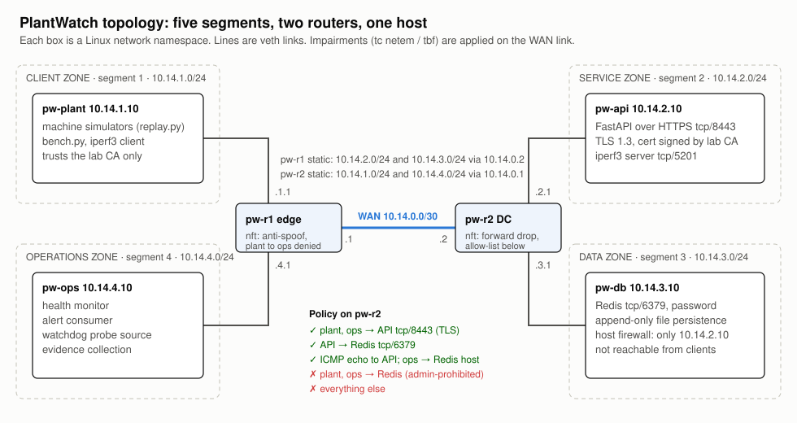

# PlantWatch: a secured, routed platform for industrial IoT telemetry

CSCI 414/514 Platform Based Development · Final Practical Exam · Option 14 (Industrial IoT and Predictive Maintenance)
Author: **[your name]** (individual submission) · Date: **[date]**

> How to finish this report: run `sudo make experiments`, then replace every
> **[bracketed]** item with the value from the named evidence file. Section 6
> can be pasted from `evidence/results.md`. Do not submit numbers you did not measure.

## 1. Purpose and scope

PlantWatch collects sensor readings from machines on a plant floor, stores them in
a NoSQL datastore in a separate data-centre network, and raises
predictive-maintenance alerts that an operations team consumes. The application is
deliberately small; the object of study is the network platform under it:
segmentation, routing, access control, encryption, observability, behaviour under
congestion, and recovery from failure.

* Inputs: readings (air temperature, process temperature, speed, torque, tool wear) per machine.
* Outputs: latest machine state, reading history, alerts.
* User operations: create a reading, read state and history, update an alert threshold, read and acknowledge alerts.

## 2. Architecture



Six network namespaces on one Linux host form four zones plus two routers. Five
IP segments are connected by veth pairs; all inter-zone traffic crosses at least
one router, and traffic between the plant and the data centre crosses both.

| Segment | Prefix | Members |
|---|---|---|
| 1 Client (plant) | 10.14.1.0/24 | pw-plant .10, pw-r1 .1 |
| 2 Application | 10.14.2.0/24 | pw-api .10, pw-r2 .1 |
| 3 Data | 10.14.3.0/24 | pw-db .10, pw-r2 .1 |
| 4 Operations | 10.14.4.0/24 | pw-ops .10, pw-r1 .1 |
| Transit (WAN) | 10.14.0.0/30 | pw-r1 .1, pw-r2 .2 |

End-to-end transaction: client in segment 1 opens TCP then TLS to 10.14.2.10:8443
→ pw-r1 forwards via its static route to pw-r2 → pw-r2's firewall accepts tcp/8443
→ the API sends `HGET` then a `MULTI ... EXEC` pipeline to Redis at 10.14.3.10:6379
through pw-r2 again → the response returns along the same path.

**Data placement.** Redis sits one router hop from the API and three hops from the
clients. A write costs the client one request round trip over the WAN plus two
Redis round trips inside the data centre. The WAN therefore dominates client
latency as soon as it is impaired, while datastore time stays constant
(Section 6 quantifies this). Keeping the database off the client path is also
what makes the "clients cannot bypass the API" boundary enforceable.

## 3. Implementation by module

### A. Network infrastructure
`lab/up.sh` creates the namespaces and links, assigns addresses, enables
`net.ipv4.ip_forward` only on the routers, and installs static routes (default
routes on hosts; two /24 routes per router across the transit link).
Evidence: `evidence/A_network/connectivity.txt` shows addresses, route tables,
traceroute plant → API with hops **[10.14.1.1, 10.14.0.2, 10.14.2.10]**, baseline RTT
**[x ms]**, and a nine-row connectivity matrix including the intended boundaries.

### B. Distributed service
FastAPI (`app/main.py`) served by uvicorn over TLS; Redis 7 as datastore. Data
model and query patterns are listed in the README. Reads of the latest state are a
single `HGETALL`; history is `XREVRANGE` on a per-machine stream; a write is one
atomic pipeline. 10,000 dataset rows are imported by a reproducible ETL script.
Evidence: `evidence/B_service/queries.txt` (create, read, update, plus 404, 422
and 405 responses, and the raw Redis structures).

### C. Network security
* **Access control.** `pw-r2` forwards with policy `drop` and five allow rules
  (`lab/firewall-r2.nft`). `pw-r1` adds anti-spoofing and blocks plant → operations.
  The Redis host has its own input filter that accepts tcp/6379 from the API address only.
  Redis additionally requires a password.
* **Encryption.** Client ↔ API uses TLS **[1.3, cipher from security.txt]** with a
  server certificate issued by a private lab CA; clients verify it against that CA only.
* **Denial test.** From the plant zone, a TCP SYN to 10.14.3.10:6379 is answered by
  pw-r2 with ICMP "admin prohibited"; the capture
  `evidence/C_security/r2_wan_security.pcap` shows the SYN and the ICMP reply, and
  the `deny_to_data` counter rises from **[n]** to **[m]**.
* TLS and ACLs do different jobs: TLS protects the content of the permitted
  path; the ACL decides which paths exist. A client without the CA is rejected by
  TLS (curl exit 60); a client aiming at Redis is rejected by the router before
  any application protocol is spoken.

Evidence: `evidence/C_security/security.txt` (12 pass/fail policy checks).

### D. Observability
* **Packets.** One traced transaction is captured at three points: the client
  interface, pw-r2's WAN side (tcp/8443) and pw-r2's data side (tcp/6379).
* **Logs.** One JSON line per API request with request id, client address,
  status, application time and datastore time; Redis log; watchdog log; a
  timestamped event log of every impairment and fault.
* **Metrics.** RTT (ping), TCP throughput and retransmits (iperf3), request
  latency percentiles, error counts, availability and outage duration.
* **Correlation.** The request id returned to the client appears in the API log;
  its timestamps line up with the TLS records on the WAN capture and the Redis
  commands (`HGET`, `MULTI`, `XADD`, `HSET`, `EXEC`) on the data capture. The
  machine id is readable **[n]** times in the Redis capture and **0** times in the
  TLS capture. For a network event with an application effect, see Section 6.2:
  the event log entry `FAULT_INJECT wan_down` at **[time]** is followed by failed
  probes in `monitor.csv` and by `PROBE_FAIL` lines in `watchdog.log`.

Evidence: `evidence/D_observability/observability.txt` and three pcap files.

### E. Network performance
`experiments/impair.sh` applies netem (delay 50 ms ± 10 ms, or 5 % loss) or tbf
(2 Mbit/s) to the egress of both routers on the WAN link, so both directions are
affected. `experiments/measure.sh` then runs the identical workload. See Section 6.1.

### F. Automation and recovery
* Deployment: `sudo make setup && sudo make up` (one command each).
* Validation: `sudo make test` runs 26 checks of routing, policy and service and exits non-zero on any failure.
* Recovery: `ops/watchdog.sh` probes `/health` from the operations zone every second;
  after three consecutive failures it diagnoses (WAN link and routes, Redis process,
  API process) and runs the matching repair. See Section 6.2.

## 4. Experimental method

Three states, each measured with the same scripts and timestamps:

1. **Baseline**: no impairment.
2. **Congested**: delay, loss and rate-limit profiles, one at a time, then removed ("recovered").
3. **Failure and recovery**: API crash, Redis crash, WAN link down.

Workload per condition: 50 pings; 5 s iperf3 TCP; `client/bench.py` with a fixed
seed: 100 writes, 100 state reads and 50 history reads (200 readings, about 36 kB)
on one keep-alive TLS connection, then 30 reads on a new TCP+TLS connection each.
Alert delivery is measured by a consumer in the operations zone that polls every
200 ms. Network time per request = client total − `X-App-Ms`.

Sample counts are small (30 to 100 per operation), so p99 values rest on one or
two requests and should be read as indications.

## 5. Dataset

AI4I 2020 Predictive Maintenance Dataset (S. Matzka, UCI, CC BY 4.0,
https://doi.org/10.24432/C5HS5C). 10,000 rows imported; machine ids and
timestamps are synthetic and labelled as such (README, "Dataset").
Import source used for this report: **[value of import_source from GET /stats]**.

## 6. Results

**[Paste the tables and charts from `evidence/results.md` here.]**

### 6.1 Baseline versus degraded network: how to read the numbers

Check each statement against your own table and keep only what your data supports.

* **Delay.** Adding 50 ms per direction adds about 100 ms per round trip. A
  keep-alive request needs one round trip, so its latency should rise by roughly
  100 ms. A request on a new connection needs three (TCP handshake, TLS 1.3
  handshake, request), so it should rise by roughly 300 ms. Server-side time
  (`X-App-Ms`) and Redis time should be unchanged, which shows the slowdown is in
  the network. Measured: write p50 **[a → b ms]**, new-connection read p50 **[c → d ms]**,
  application time **[e → f ms]**.
* **Loss.** The median barely moves because most requests lose no packet, but the
  tail grows: a lost segment waits for a retransmission timeout (Linux minimum
  about 200 ms), and a lost SYN waits about 1 s. Measured: p50 **[..]**, p95 **[..]**,
  p99 **[..]**, iperf3 retransmits **[x → y]**, throughput **[x → y Mbit/s]**.
* **Rate limit.** Small requests are unaffected; the 36 kB history response takes
  about size ÷ rate = 36 kB × 8 ÷ 2 Mbit/s ≈ 145 ms longer. Measured: history read
  p50 **[a → b ms]**, write p50 **[a → b ms]**, iperf3 **[x Mbit/s]**.
* **Alert delivery.** Delay to the operations zone = uplink + API + up to one
  polling interval (200 ms) + downlink. Measured p50 **[baseline → delay]**.
* **Recovered.** After clearing the qdisc the figures return to baseline: **[values]**.

Network versus application bottleneck: in every degraded condition the
server-reported time stays within **[x]** ms of baseline while the client total
grows, so the bottleneck is the WAN link. The application becomes the bottleneck
only for the history query at baseline, where Redis time (**[x ms]**) exceeds
network time (**[y ms]**).

### 6.2 Failure and recovery

**[Paste the outage table and timeline chart.]** For each fault state: symptom at
the client (connection refused / HTTP 503 / unreachable), detection time,
restoration time, and proof (the same round-trip transaction passes again;
`readings_total` before and after the Redis crash: **[n → n+…]**, showing the
append-only file preserved the data).

One observation worth explaining: bringing the WAN interface back up is not
enough. Linux removes static routes that use an interface when it goes down, so
the recovery action re-adds the routes on both routers (`net_repair`).

## 7. Limitations and what I would do next

* Redis traffic is unencrypted inside the data segment (visible in Module D).
* Single host: baseline latency is microseconds; real links would shift every number.
* Static routing; no redundancy, so the WAN link is a single point of failure.
* Small sample sizes; no confidence intervals.
* **[If netem was unavailable: the delay profile was not measured and loss used an nftables random-drop rule instead of netem.]**

## 8. Reproduction

```bash
git clone <repo> && cd plantwatch
sudo make setup && sudo make up && sudo make test && sudo make experiments
```

Environment used: **[Windows version, WSL version, `uname -r`, Ubuntu release]**.

## 9. Contribution statement

Individual project. **[State what you did yourself, and acknowledge any tools or
assistance you used, following the course policy.]**
