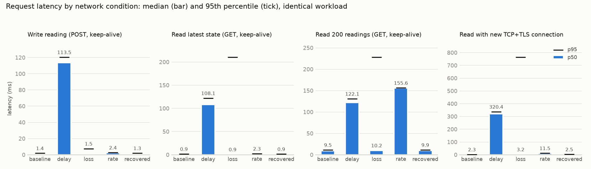
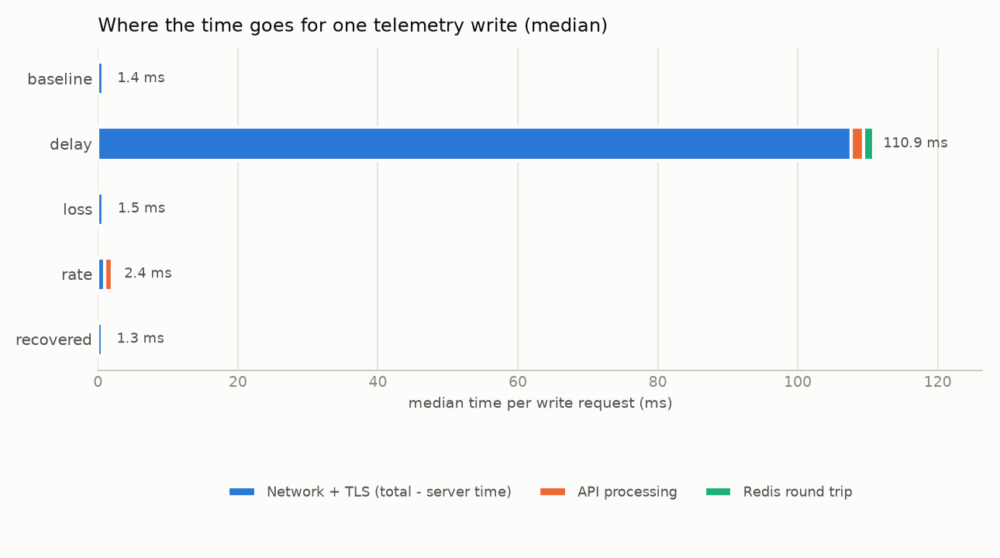
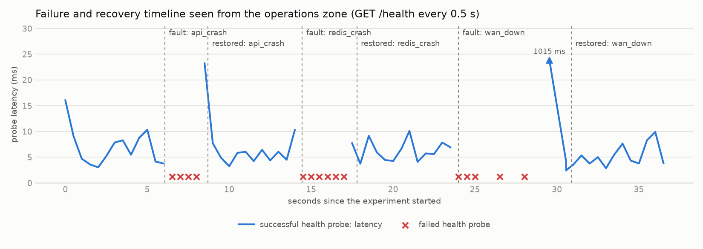

# PlantWatch - measured results

Generated 2026-11-15 16:35:33 -0600 by `experiments/make_report.py` from the raw files in `evidence/`.
All figures below are measurements from this machine; nothing is typed in by hand.

## State 1 and 2: baseline versus degraded network

Method: for each condition the same script (`experiments/measure.sh`) runs 50 pings (plant to API), a 5 s iperf3 TCP test, and `client/bench.py` (100 writes, 100 state reads, 50 history reads on one keep-alive TLS connection, then 30 reads each on a new TCP+TLS connection; fixed seed). Impairments are applied on the WAN link between the two routers, in both directions.

| Condition | Impairment | RTT avg (ms) | RTT mdev (ms) | Ping loss | TCP throughput (Mbit/s) | TCP retransmits | Requests OK | Requests/s |
|---|---|---:|---:|---:|---:|---:|---:|---:|
| baseline | no impairment | 0.10 | 0.05 | 0% | 6859.7 | 2472 | 280/280 | 334.0 |
| delay | netem delay 50ms  10ms per direction | 101.87 | 8.34 | 0% | 94.2 | 3125 | 280/280 | 7.5 |
| loss | netem loss 5% per direction | 0.13 | 0.07 | 14% | 22.0 | 553 | 280/280 | 39.3 |
| rate | tbf rate 2Mbit per direction | 0.11 | 0.06 | 0% | 1.9 | 27 | 280/280 | 35.2 |
| recovered | no impairment | 0.10 | 0.04 | 0% | 6889.8 | 4034 | 280/280 | 330.5 |

Application latency per operation (ms; successful requests only):

| Operation | Condition | n | errors | p50 | p95 | p99 | of p50: network | API processing | Redis |
|---|---|---:|---:|---:|---:|---:|---:|---:|---:|
| Write reading (POST, keep-alive) | baseline | 100 | 0 | 1.4 | 1.9 | 2.2 | 0.7 | 0.32 | 0.43 |
| Write reading (POST, keep-alive) | delay | 100 | 0 | 113.5 | 120.4 | 123.9 | 107.6 | 1.74 | 1.50 |
| Write reading (POST, keep-alive) | loss | 100 | 0 | 1.5 | 7.6 | 15.9 | 0.7 | 0.32 | 0.43 |
| Write reading (POST, keep-alive) | rate | 100 | 0 | 2.4 | 2.7 | 3.5 | 1.0 | 1.06 | 0.39 |
| Write reading (POST, keep-alive) | recovered | 100 | 0 | 1.3 | 2.0 | 3.1 | 0.6 | 0.31 | 0.40 |
| Read latest state (GET, keep-alive) | baseline | 100 | 0 | 0.9 | 1.8 | 2.1 | 0.6 | 0.13 | 0.17 |
| Read latest state (GET, keep-alive) | delay | 100 | 0 | 108.1 | 122.0 | 123.5 | 106.7 | 0.50 | 0.77 |
| Read latest state (GET, keep-alive) | loss | 100 | 0 | 0.9 | 210.4 | 212.7 | 0.6 | 0.13 | 0.17 |
| Read latest state (GET, keep-alive) | rate | 100 | 0 | 2.3 | 2.4 | 2.5 | 2.0 | 0.13 | 0.17 |
| Read latest state (GET, keep-alive) | recovered | 100 | 0 | 0.9 | 1.6 | 1.8 | 0.6 | 0.13 | 0.17 |
| Read 200 readings (GET, keep-alive) | baseline | 50 | 0 | 9.5 | 11.4 | 17.7 | 0.9 | 1.80 | 6.78 |
| Read 200 readings (GET, keep-alive) | delay | 50 | 0 | 122.1 | 131.0 | 133.7 | 111.0 | 1.96 | 8.17 |
| Read 200 readings (GET, keep-alive) | loss | 50 | 0 | 10.2 | 228.1 | 333.7 | 1.3 | 1.86 | 6.84 |
| Read 200 readings (GET, keep-alive) | rate | 50 | 0 | 155.6 | 156.5 | 156.7 | 144.8 | 1.97 | 8.45 |
| Read 200 readings (GET, keep-alive) | recovered | 50 | 0 | 9.9 | 11.5 | 11.9 | 0.9 | 1.91 | 6.94 |
| Read with new TCP+TLS connection | baseline | 30 | 0 | 2.3 | 2.7 | 2.8 | 1.9 | 0.14 | 0.18 |
| Read with new TCP+TLS connection | delay | 30 | 0 | 320.4 | 337.1 | 341.2 | 319.4 | 0.53 | 0.81 |
| Read with new TCP+TLS connection | loss | 30 | 0 | 3.2 | 764.4 | 1180.5 | 2.7 | 0.16 | 0.29 |
| Read with new TCP+TLS connection | rate | 30 | 0 | 11.5 | 12.3 | 13.0 | 10.9 | 0.23 | 0.29 |
| Read with new TCP+TLS connection | recovered | 30 | 0 | 2.5 | 3.4 | 3.6 | 2.1 | 0.15 | 0.20 |

Alert delivery delay: sensor timestamp on the plant floor to first sight by the operations zone (ms):

| Condition | alerts | uplink p50 (plant to API) | delivery p50 | delivery p95 |
|---|---:|---:|---:|---:|
| baseline | 20 | 0.6 | 74.5 | 196.2 |
| delay | 20 | 56.6 | 277.9 | 432.1 |
| loss | 20 | 0.6 | 153.6 | 195.6 |
| rate | 20 | 1.6 | 127.4 | 196.2 |
| recovered | 20 | 0.6 | 127.7 | 188.3 |

### What the numbers show

- **delay** (netem delay 50ms  10ms per direction): write p50 1.4 -> 113.5 ms and p95 1.9 -> 120.4 ms, while server-side time stayed at 3.24 ms (baseline 0.75 ms) with Redis at 1.50 ms. New-connection reads went 2.3 -> 320.4 ms; 200-reading history reads 9.5 -> 122.1 ms. TCP throughput 6859.7 -> 94.2 Mbit/s, retransmits 2472 -> 3125. Alert delivery p50 74.5 -> 277.9 ms. Errors: 0 of 280 requests.
- **loss** (netem loss 5% per direction): write p50 1.4 -> 1.5 ms and p95 1.9 -> 7.6 ms, while server-side time stayed at 0.75 ms (baseline 0.75 ms) with Redis at 0.43 ms. New-connection reads went 2.3 -> 3.2 ms; 200-reading history reads 9.5 -> 10.2 ms. TCP throughput 6859.7 -> 22.0 Mbit/s, retransmits 2472 -> 553. Alert delivery p50 74.5 -> 153.6 ms. Errors: 0 of 280 requests.
- **rate** (tbf rate 2Mbit per direction): write p50 1.4 -> 2.4 ms and p95 1.9 -> 2.7 ms, while server-side time stayed at 1.45 ms (baseline 0.75 ms) with Redis at 0.39 ms. New-connection reads went 2.3 -> 11.5 ms; 200-reading history reads 9.5 -> 155.6 ms. TCP throughput 6859.7 -> 1.9 Mbit/s, retransmits 2472 -> 27. Alert delivery p50 74.5 -> 127.4 ms. Errors: 0 of 280 requests.
- **recovered**: with the impairment removed, write p50 is 1.3 ms (baseline 1.4 ms) and RTT 0.10 ms (baseline 0.10 ms).

## State 3: failure and recovery

Method: `experiments/F_recovery.sh` injects three faults while `ops/monitor.py` probes `/health` from the operations zone and `ops/watchdog.sh` (1 s probe, 3 consecutive failures) repairs the system. Times are measured from the moment of fault injection.

| Fault | Symptom seen by the probe | First failed probe after (s) | Watchdog detected after (s) | Service restored after (s) | Failed probes | Recovery action |
|---|---|---:|---:|---:|---:|---|
| api_crash | ConnectError | 0.4 | 2.0 | 2.5 | 4 | start_api |
| redis_crash | HTTP 503 | 0.0 | 3.0 | 3.0 | 6 | start_redis (data restored from append-only file) |
| wan_down | ConnectError, ConnectTimeout | 0.0 | 5.9 | 6.6 | 5 | net_repair: link up + re-add static routes on pw-r1/pw-r2 |

Health probe: 74 probes over 37 s (one every 0.5 s, 1.5 s timeout), 59 successful = 79.7% availability during the experiment; median healthy probe latency 5.2 ms.

